# Darren Haryanto

Full-stack and mobile developer. I just finished my thesis, and now I'm spending more time on AI/ML and data mining. Naming things is still the hardest part of programming for me.

<samp>
  <a href="https://darrenharyanto.com">portfolio</a> .
  <a href="mailto:darrenharyanto@gmail.com">email</a> .
  <a href="https://github.com/OkToRen?tab=repositories">repositories</a>
</samp>

## Projects

- [Lively](https://github.com/LivelyHub): WhatsApp and Telegram companion that checks in on elderly parents every day, then reports back to their family in a React Native app. Built at GarudaHacks 7.0.
- [Bantu](https://github.com/Vernandio/Bantu---IOFest): built for IOFest 2026. Small businesses post small jobs, and students and freelancers take them on and build up a verified portfolio.
- [Portofolio](https://github.com/OkToRen/Portofolio): my portfolio site, built with Astro.
- pdf-Processor: self-hosted web app for merging, splitting and compressing PDFs (private repo).
- Intern Repo: work from my internship (private repo).

## Recently pushed

<!-- recent:start -->
- [Portofolio](https://github.com/OkToRen/Portofolio) (Astro), 2026-11-02
- [PreThesisS1](https://github.com/OkToRen/PreThesisS1) (Jupyter Notebook), 2026-10-12
- [sectors-hackathon](https://github.com/OkToRen/sectors-hackathon) (Python), 2026-10-08
- [YieldLine](https://github.com/OkToRen/YieldLine) (TypeScript), 2026-09-26
- [resetos](https://github.com/OkToRen/resetos), 2026-05-02
<!-- recent:end -->

## Homelab

I run my own server on Ubuntu Server and look after everything from the OS up, including the networking and reverse proxy. Gitea handles my git hosting and CI/CD pipelines. Services run in Docker, Cloudflare Zero Trust tunnels keep them off the public internet, and object storage is MinIO and SeaweedFS.

## Stack

- Languages: TypeScript, JavaScript, Go, Python, Kotlin, Java, PHP, R, HTML, CSS
- Frameworks: Next.js, React, React Native, Vite, Fastify, Astro, Laravel, Node.js
- Cloud and infrastructure: Firebase, Azure, GCP, Cloudflare, Docker, MinIO, SeaweedFS, Meta for Developers
- Data and ML: Jupyter, Pandas, NumPy

## GitHub stats

  
  

